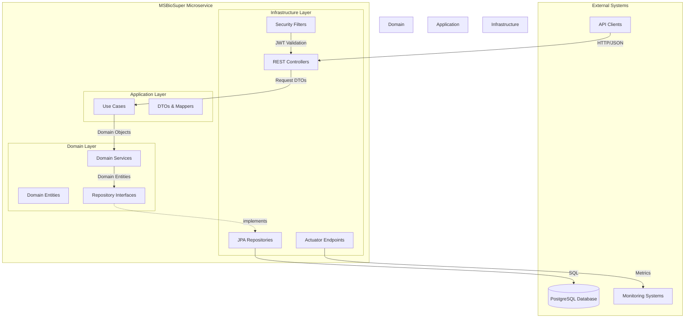

# Design Document: MSBioSuper Java 21 Migration

## Document Information
- **Feature**: MSBioSuper Java 21 Migration
- **Version**: 1.0
- **Created**: 2026-04-21
- **Author**: Josias Rubén Aldaz Arcalles
- **Status**: DRAFT

---

## 1. Overview

### 1.1 Purpose

This design document provides a comprehensive technical blueprint for migrating the MSBioSuper microservice from Java 8 to Java 21, transforming it from a monolithic WAR-based application to a modern, containerized microservice following hexagonal architecture principles.

### 1.2 Scope

The design covers:
- **Runtime Migration**: Java 8 → Java 21 LTS with modern JVM features
- **Framework Modernization**: Spring Boot 2.5.2 → 3.3.x, Hibernate 4.x → 6.5.x
- **Architectural Transformation**: Monolithic → Hexagonal (Ports & Adapters)
- **Security Enhancement**: JWT modernization, Spring Security 6 implementation
- **API Documentation**: Swagger 2 → OpenAPI 3.0 with SpringDoc
- **Infrastructure**: WAR → JAR packaging, Docker containerization
- **Observability**: Actuator, Micrometer metrics, structured logging

### 1.3 Design Goals

1. **Maintainability**: Clean separation of concerns through hexagonal architecture
2. **Testability**: High test coverage with unit, integration, and property-based tests
3. **Performance**: Leverage Java 21 Virtual Threads for improved concurrency
4. **Security**: Modern JWT implementation with externalized secrets
5. **Observability**: Comprehensive monitoring and health checks
6. **Backward Compatibility**: Maintain existing API contracts during migration

### 1.4 Key Design Decisions

| Decision | Rationale |
|----------|-----------|
| Hexagonal Architecture | Isolates business logic from infrastructure concerns |
| Spring Data JPA | Eliminates boilerplate DAO code, provides repository pattern |
| Java 21 Records for DTOs | Immutable, concise data carriers with built-in equals/hashCode |
| Virtual Threads | Improved scalability for I/O-bound operations |
| JAR packaging | Modern microservice standard, embedded server |
| OpenAPI 3.0 | Industry standard for API documentation |
| HikariCP | High-performance connection pooling |
| Testcontainers | Realistic integration testing with PostgreSQL |

---

## 2. Architecture

### 2.1 High-Level Architecture

The application follows **Hexagonal Architecture** (Ports and Adapters pattern), which provides clear separation between business logic and technical infrastructure.



### 2.2 Hexagonal Architecture Layers

#### 2.2.1 Domain Layer (Core Business Logic)

**Purpose**: Contains pure business logic, independent of frameworks and infrastructure.

**Components**:
- **Domain Entities**: Business objects with behavior (ResumenPesca, Liquidacion, etc.)
- **Repository Interfaces (Ports)**: Contracts for data access
- **Domain Services**: Complex business logic that doesn't fit in entities
- **Domain Exceptions**: Business rule violations

**Rules**:
- No dependencies on Spring, Hibernate, or any framework
- No annotations except standard Java (no @Entity, @Service, etc.)
- Pure Java objects with business logic
- Depends only on Java standard library

#### 2.2.2 Application Layer (Use Cases)

**Purpose**: Orchestrates domain objects to fulfill specific use cases.

**Components**:
- **Use Cases**: Application-specific business rules (GetResumenPescaUseCase)
- **DTOs**: Data transfer objects for input/output
- **Mappers**: Convert between DTOs and domain entities
- **Application Services**: Coordinate multiple use cases

**Rules**:
- Depends on domain layer
- No direct dependency on infrastructure
- Orchestrates domain objects
- Handles transaction boundaries

#### 2.2.3 Infrastructure Layer (Technical Details)

**Purpose**: Implements technical concerns and adapters to external systems.

**Components**:
- **REST Controllers**: HTTP endpoints (adapters)
- **JPA Repositories**: Database access implementations (adapters)
- **Security Configuration**: JWT, Spring Security setup
- **Configuration Classes**: Spring beans, database config
- **Exception Handlers**: Global error handling

**Rules**:
- Depends on application and domain layers
- Implements repository interfaces from domain
- Contains all framework-specific code
- Handles technical concerns (logging, monitoring, etc.)

### 2.3 Layer Interaction Flow

```mermaid
sequenceDiagram
    participant Client
    participant Controller as REST Controller<br/>(Infrastructure)
    participant UseCase as Use Case<br/>(Application)
    participant Service as Domain Service<br/>(Domain)
    participant Repo as Repository Interface<br/>(Domain)
    participant JPA as JPA Repository<br/>(Infrastructure)
    participant DB as PostgreSQL
    
    Client->>Controller: POST /api/v1/resumen-pesca
    Controller->>Controller: Validate JWT
    Controller->>UseCase: execute(request)
    UseCase->>UseCase: Map DTO to Domain
    UseCase->>Service: getResumenPesca(params)
    Service->>Service: Apply business rules
    Service->>Repo: findByDateRange(start, end)
    Repo->>JPA: Implementation
    JPA->>DB: SELECT query
    DB-->>JPA: Result set
    JPA-->>Repo: Domain entities
    Repo-->>Service: Domain entities
    Service-->>UseCase: Processed entities
    UseCase->>UseCase: Map Domain to DTO
    UseCase-->>Controller: Response DTO
    Controller-->>Client: HTTP 200 + JSON
